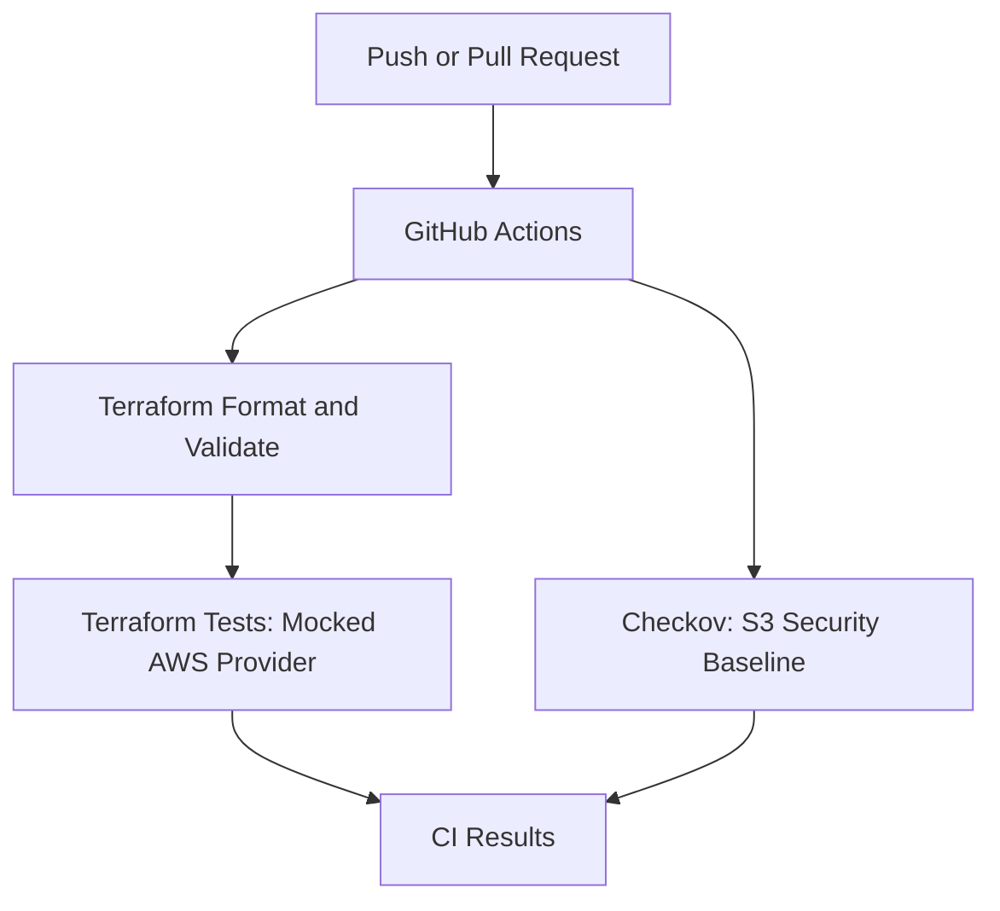

# AWS Infrastructure Automation | Terraform & GitHub Actions

An educational DevSecOps project with Terraform, GitHub Actions, and automated
security checks. The current implementation validates an AWS S3 configuration
without an AWS account or cloud deployment.

## What Works Without AWS Access

- Terraform formatting and configuration validation.
- Five test scenarios using a mocked AWS provider, including rejected inputs.
- A focused Checkov security baseline for the example storage bucket.
- A GitHub Actions workflow triggered by pushes, pull requests, or manual runs.

The workflow is implemented locally; a successful GitHub Actions run must be
confirmed after publishing. No AWS resources have been provisioned. Deployment,
remote state, IAM, and OIDC remain future work. This project currently implements
CI, not a completed CD deployment.

## Architecture



## Repository Structure

```text
.
|-- .github/workflows/ci.yml
|-- .checkov.yml
|-- terraform/
|   |-- main.tf
|   |-- providers.tf
|   |-- versions.tf
|   |-- variables.tf
|   |-- outputs.tf
|   |-- backend.tf
|   |-- .terraform.lock.hcl
|   `-- tests/storage.tftest.hcl
|-- .gitattributes
|-- .gitignore
|-- LICENSE
`-- README.md
```

## Example Infrastructure

The Terraform configuration describes a storage bucket with versioning, SSE-S3
encryption, all four public access block settings, and a policy denying HTTP
access to the bucket and objects. `force_destroy` is disabled. The bucket prefix
uses the first 20 project-name characters and the environment; the real provider
would append a unique suffix when deploying.

This bucket is an application example, not the Terraform state backend.
`backend.tf` remains a placeholder. A future backend requires a separate bootstrap.

| Input | Default | Validation |
| --- | --- | --- |
| `project_name` | `aws-terraform-cicd-pipeline` | 3-40 lowercase letters, digits, or single hyphens; starts with a letter and ends with a letter or digit |
| `environment` | `dev` | `dev`, `staging`, or `prod` |
| `aws_region` | `us-east-1` | Region format; account access and region availability are not verified |

Null inputs are rejected. The provider defines `Project`, `Environment`, and
`ManagedBy = Terraform` as default tags for resources that support them.

## Run Locally

Requirements: Git, Terraform >= 1.10.0 and < 2.0.0, and internet access for initial
provider downloads. CI uses Terraform 1.16.6. The AWS provider constraint is
`~> 6.0`, and `.terraform.lock.hcl` records the selected version.

From the repository root:

```powershell
terraform fmt -check -recursive
terraform -chdir=terraform init -backend=false -lockfile=readonly
terraform -chdir=terraform validate
terraform -chdir=terraform test
```

Every test uses `command = plan` and the mocked provider declared in the test
file. They check configuration intent without AWS credentials or API calls.
Mock tests do not prove permissions, service behavior, or deployment success.
The mock configuration applies only to `terraform test`: an ordinary `plan` or
`apply` would use the real AWS provider. Do not run them for this demonstration.

For the same security scan used by CI, with Docker installed:

```powershell
docker run --rm --mount "type=bind,source=${PWD},target=/work,readonly" --workdir /work ghcr.io/bridgecrewio/checkov:3.3.29 --config-file .checkov.yml
```

Alternatively, use Checkov 3.3.29 in a Python virtual environment and run
`checkov --config-file .checkov.yml`.

## Security Scope

`.checkov.yml` selects six controls: encryption (`CKV_AWS_19`), versioning
(`CKV_AWS_21`), and public access blocking (`CKV_AWS_53` through `CKV_AWS_56`).
A test separately checks that the policy contains only the intended HTTP-deny
statement. Failed selected controls fail CI; no soft-fail or inline suppressions are
configured. This explicit teaching baseline does not cover every Checkov policy.
Access logging, replication, customer-managed KMS keys, lifecycle policies, and
runtime cloud controls require a later requirements review.

Actions are pinned by commit SHA. The workflow uses read-only repository
permissions, disables persisted checkout credentials, and sets timeouts and
concurrency cancellation. It requests no AWS secrets or OIDC permissions.

Never commit states, saved plans, or credentials. The existing `.gitignore`
excludes local Terraform data while keeping the provider lock file tracked.

## Demonstrate the Project

See [local validation evidence](docs/validation.md) for the commands and results
actually obtained during development.

After reviewing and publishing the files, open the repository's Actions tab and
confirm that both jobs pass. Capture the actual run and its commit identifier.
For a failure demonstration, use a temporary branch to disable a public access
block setting, confirm the checks fail, and restore the secure setting.

Suggested portfolio description after a successful GitHub run:

> Built an educational Terraform CI pipeline with GitHub Actions, mocked AWS
> tests, input validation, and a Checkov S3 security baseline. Validated the IaC
> configuration without provisioning cloud resources. AWS deployment and OIDC
> are planned extensions.

## Future Work

- Bootstrap a private, encrypted, versioned S3 state backend with state locking.
- Configure GitHub-to-AWS OIDC with scoped IAM roles.
- Add authenticated planning and reviewed deployment approvals.
- Test deployment and cleanup in a real AWS account and record the evidence.

Future AWS deployments may incur charges. GitHub-hosted runner usage is subject
to the account's Actions billing and usage policies.

## References

- [Terraform provider mocking](https://developer.hashicorp.com/terraform/language/tests/mocking)
- [AWS provider documentation](https://registry.terraform.io/providers/hashicorp/aws/latest/docs)
- [Checkov policy index](https://www.checkov.io/5.Policy%20Index/terraform.html)

## License

MIT. See [LICENSE](LICENSE).
