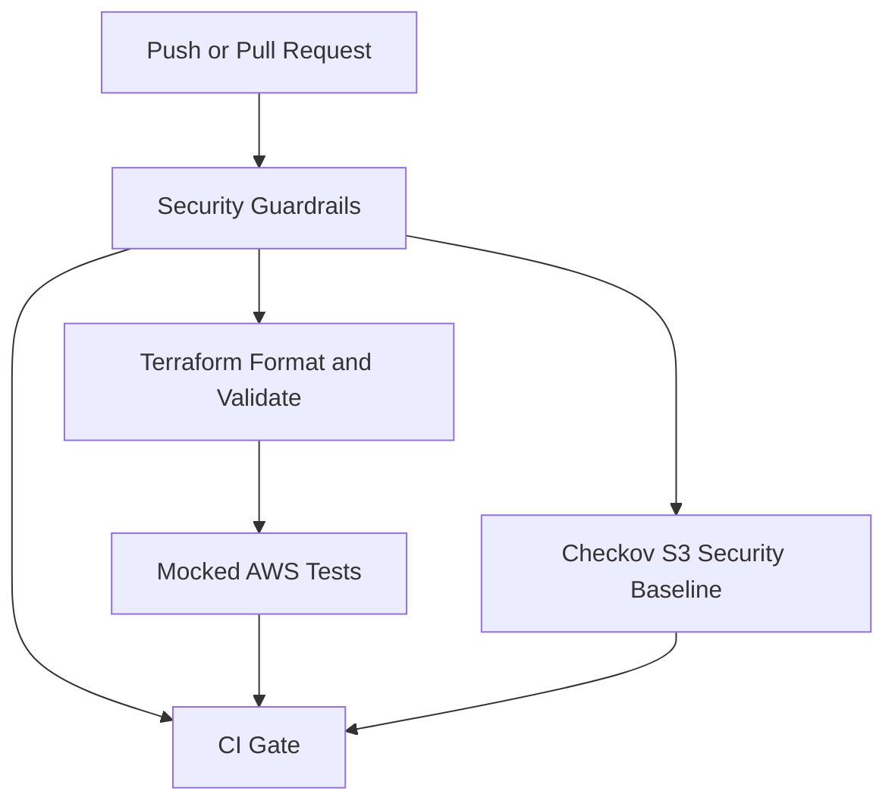

# Terraform S3 Security | GitHub Actions

Validate the security of an S3 bucket configuration before approving infrastructure
changes. This educational CI project combines Terraform tests, a focused Checkov
baseline, and GitHub Actions guardrails without requiring AWS access.

## Scope

The project describes one S3 bucket and its related security settings. It checks
encryption, versioning, public access blocking, an HTTPS-only bucket policy, and
validated input variables. No AWS resources have been provisioned.

Tests use a mocked AWS provider. They verify configuration intent, not actual
AWS behavior or permissions. This is a CI validation project; cloud deployment,
OIDC authentication, and an S3 remote state backend are future work. The bucket
in `main.tf` is the resource being tested, not a backend for Terraform state.

## Pipeline



| Job | Purpose |
| --- | --- |
| Security Guardrails | Reject sensitive tracked files, detect secrets with Gitleaks, and audit workflows with Zizmor |
| Format, Validate and Mock Tests | Check Terraform formatting, configuration, and five positive/negative test scenarios |
| S3 Security Baseline | Run six explicitly selected Checkov controls |
| CI Gate | Require every validation job to succeed, including rejecting skipped or cancelled dependencies |

The workflow runs on push, pull request, and manual dispatch. It uses pinned
Actions, read-only default token permissions, timeouts, and a provider lock file
with Windows and Linux checksums. To prevent unsafe merges, configure `CI Gate`
as a required status check in the repository's branch rules.

## S3 Security Controls

- SSE-S3 encryption (`AES256`).
- Object versioning enabled.
- All four S3 public access block settings enabled.
- Bucket policy denying insecure HTTP transport for the bucket and its objects.
- `force_destroy = false` to avoid automatically deleting objects on removal.
- Standard `Project`, `Environment`, and `ManagedBy` tags.

Checkov checks encryption (`CKV_AWS_19`), versioning (`CKV_AWS_21`), and public
access blocking (`CKV_AWS_53` through `CKV_AWS_56`). Terraform tests separately
verify the intended HTTPS-deny policy and input validation. This is a focused
baseline, not a complete production security audit. Logging, replication,
customer-managed KMS keys, and runtime policies are outside the current scope.

## Repository Structure

```text
.
|-- .github/workflows/ci.yml
|-- .checkov.yml
|-- terraform/
|   |-- main.tf
|   |-- providers.tf
|   |-- versions.tf
|   |-- variables.tf
|   |-- outputs.tf
|   |-- backend.tf
|   |-- .terraform.lock.hcl
|   `-- tests/storage.tftest.hcl
|-- scripts/check_tracked_files.py
|-- tests/test_repository_guardrails.py
|-- docs/security-guardrails.md
|-- docs/validation.md
|-- .gitattributes
|-- .gitignore
|-- LICENSE
`-- README.md
```

## Configuration

| Variable | Default | Validation |
| --- | --- | --- |
| `project_name` | `aws-terraform-cicd-pipeline` | 3-40 lowercase letters, digits, or single hyphens; starts with a letter and ends with a letter or digit |
| `environment` | `dev` | `dev`, `staging`, or `prod` |
| `aws_region` | `us-east-1` | Region name format, not actual region availability |

All inputs reject null values. The bucket prefix uses the first 20 project-name
characters and the environment; the real AWS provider would append a suffix.

## Run Locally

Requirements: Git, Python 3.10+ for repository guardrails, Terraform >= 1.10.0
and < 2.0.0, and Checkov 3.3.29 in a Python virtual environment. Initial provider
and tool downloads require internet access. CI uses Terraform 1.16.6 and provider
`hashicorp/aws ~> 6.0`, with its selected version recorded in the lock file.

Run from the repository root:

```powershell
python -m unittest discover -s tests -v
python scripts/check_tracked_files.py
terraform fmt -check -recursive
terraform -chdir=terraform init -backend=false -lockfile=readonly
terraform -chdir=terraform validate
terraform -chdir=terraform test
checkov --config-file .checkov.yml
```

Every Terraform test uses `command = plan` with a mocked provider. These commands
need no AWS credentials. An ordinary `terraform plan` or `apply` uses the real
provider and is not part of this demonstration. `backend.tf` is a placeholder;
no remote backend is configured. Never commit state, plans, or credentials.

## Demonstrate a Rejected Change

1. Create a demonstration branch and change `block_public_acls` from `true` to
   `false` in `terraform/main.tf`.
2. Run Terraform tests and Checkov. The secure-storage test and `CKV_AWS_53`
   should reject the change. Do not apply this configuration to AWS.
3. Open a pull request to demonstrate the failing checks and `CI Gate`.
4. Restore `block_public_acls = true`, publish the correction, and capture the
   successful run. Do not merge the intentionally unsafe version.

This provides a concrete before/after example for a portfolio: an unsafe
configuration is rejected before cloud provisioning. See
[validation evidence](docs/validation.md) for checks actually executed and
[guardrail details](docs/security-guardrails.md) for limits and branch settings.

## Portfolio Description

> Developed a CI pipeline for an AWS S3 configuration using Terraform and GitHub
> Actions, with mocked AWS tests, a Checkov security baseline, and guardrails for
> secrets and sensitive files. Validated infrastructure code without provisioning
> cloud resources.

The earlier Terraform workflow has a successful GitHub run. The simplified
workflow must be confirmed after publishing; local validation is not evidence
of an AWS deployment.

## Future Work

With AWS access, bootstrap an S3 state backend, configure scoped OIDC access,
and add reviewed planning and deployment. Those features are not implemented
or verified by the current project. Future AWS deployments may incur charges.

## References

- [Terraform provider mocking](https://developer.hashicorp.com/terraform/language/tests/mocking)
- [AWS provider](https://registry.terraform.io/providers/hashicorp/aws/latest/docs)
- [Checkov policy index](https://www.checkov.io/5.Policy%20Index/terraform.html)

## License

MIT. See [LICENSE](LICENSE).
